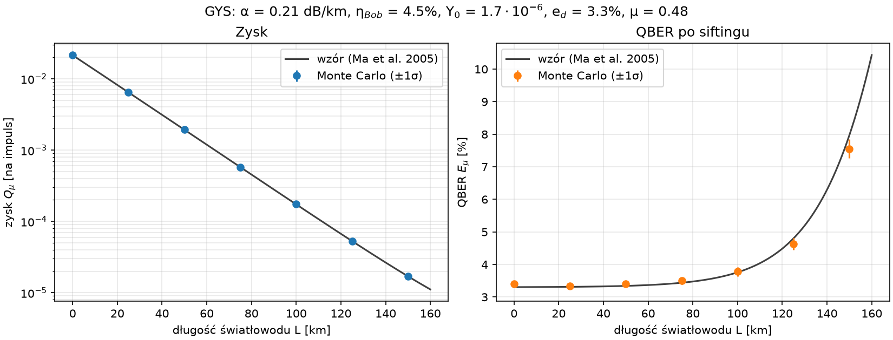
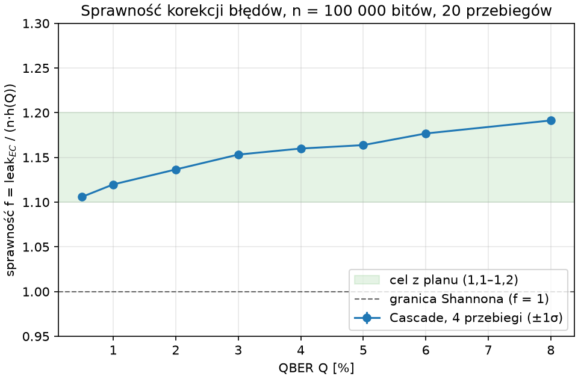
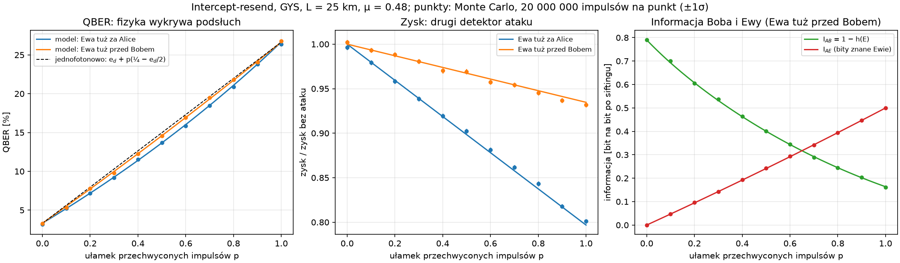
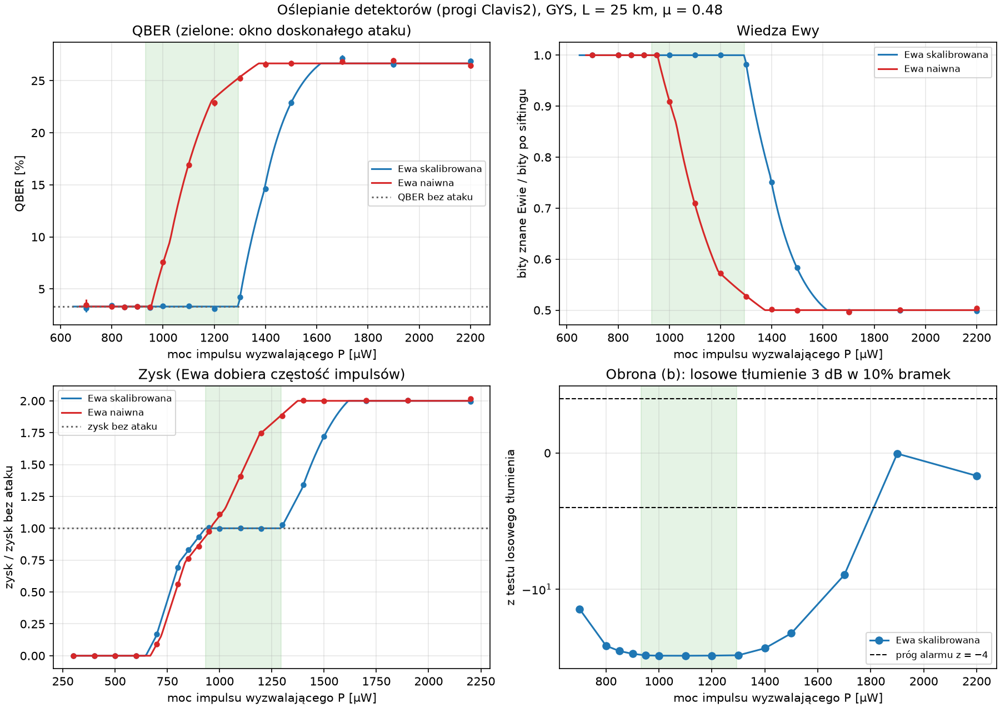
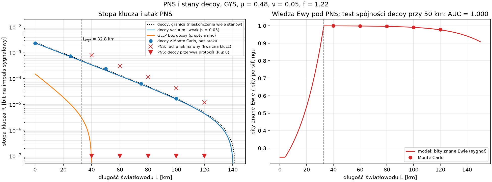
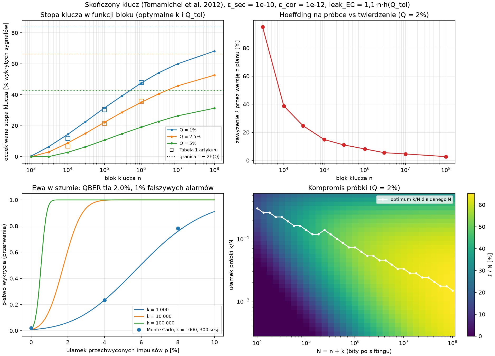
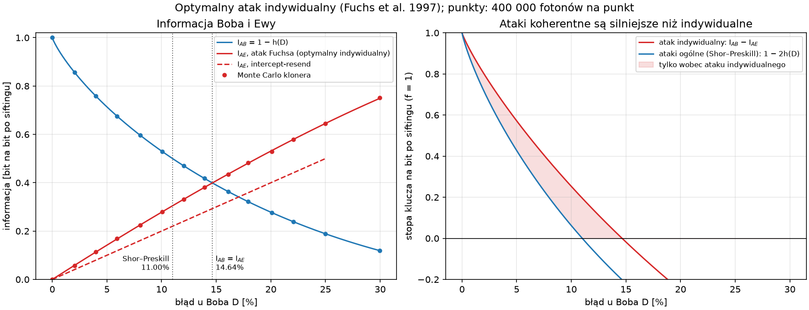
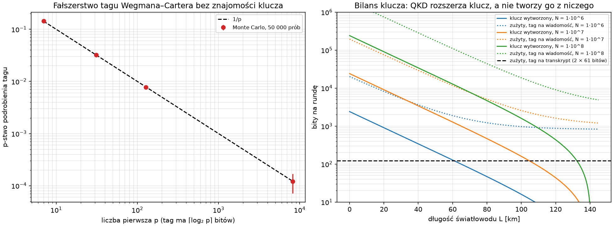

# bb84-attacks

Symulator BB84 z atakami. Każdy wynik Monte Carlo jest porównywany ze wzorem analitycznym albo z wynikiem z publikacji.

Model: polaryzacyjny BB84, światłowód 1550 nm, źródło słabych impulsów koherentnych (WCP), dwa detektory SPAD po stronie Boba. Parametry startowe z eksperymentu GYS (Ma, Qi, Zhao, Lo 2005).

Pomost do kryptografii postkwantowej: kanał klasyczny można uwierzytelniać kluczem współdzielonym (Wegman–Carter), podpisem ML-DSA (FIPS 204) albo hybrydowo. Symulator pokazuje, kiedy takie uwierzytelnianie chroni klucz QKD, i porównuje QKD z ML-KEM w różnych modelach zagrożeń.

> **Status:** fazy F1 i F2 zakończone (bramki G1 i G2 zaliczone), faza F3 zakończona (bramka G3 zaliczona): ataki 1 (intercept-resend), 2 (oślepianie detektorów z obronami) i 3 (PNS ze stanami decoy). Fizyka bez ataków zgadza się ze wzorami na 0–150 km, postprocessing daje identyczne klucze z poprawnie policzonym wyciekiem. W fazie F4 gotowe: skończony klucz (Tomamichel et al. 2012) atak 6 (Fuchs), czyli komplet czterech wyników kontrolnych z planu, oraz atak 7 (MITM z uwierzytelnianiem Wegmana–Cartera); dalej uwierzytelnianie postkwantowe (wariant E): [ROADMAP.md](ROADMAP.md).

## Wyniki



Monte Carlo (punkty) na tle wzorów Ma et al. 2005 (linie) dla parametrów eksperymentu GYS: do 10⁹ impulsów na punkt, wszystkie punkty w granicach |z| < 1,8.



Cascade (4 przebiegi) ujawnia 1,11–1,19 razy więcej bitów niż granica Shannona dla QBER 0,5–8%, w przedziale zakładanym w planie.



Atak intercept-resend przy 25 km: QBER rośnie do ~26,5% (fizyka wykrywa podsłuch), a Ewa tuż za Alice zdradza się dodatkowo spadkiem zysku o 20%. Przy pełnym ataku Ewa zna połowę bitów po siftingu na pewno, a zgaduje 75%. QBER(p) dla źródła WCP leży poniżej prostej z planu, bo impulsy przechwycone są wykrywane rzadziej.



Oślepianie detektorów (progi Clavis2 z Lydersena et al.): skalibrowana Ewa przy mocy impulsu 950–1300 µW zostawia QBER i zysk bez zmian, a zna 100% klucza. Losowe tłumienie 3 dB w 10% bramek wykrywa ją z z ≈ −35. Żadna moc impulsu nie przechodzi jednocześnie testu QBER i testu tłumienia. Krzywe ROC obu obron: [figures/e05_blinding_roc.png](figures/e05_blinding_roc.png).



Atak PNS i stany decoy: GLLP bez decoy kończy się przy ~40 km, decoy vacuum+weak sięga ~140 km (punkty: estymata z Monte Carlo). Za odległością krytyczną 32,8 km Ewa zna 98–100% klucza przy niezmienionym QBER i zysku. Rachunek naiwny („wszystkie detekcje są jednofotonowe”) daje wtedy dodatnią stopę, a decoy przerywa protokół.



Skończony klucz (Tomamichel et al. 2012): stopa rośnie z blokiem n w stronę granicy 1 − 2h(Q), a kwadraty to Tabela 1 artykułu. Uproszczenie z planu (Hoeffding na samej próbce) zawyża długość klucza o 95% przy n = 3000 i o 15% przy 10⁵. „Ewa w szumie”: przy próbce 1000 bitów przechwycenie 4% impulsów wykrywa się tylko w 23% przypadków.



Optymalny atak indywidualny (Fuchs et al. 1997) jako kloner fazowo-kowariantny, zweryfikowany w QuTiP: I_AB = I_AE przy D* = 14,64%, a próg dla ataków ogólnych (Shor–Preskill) to 11,00%. Zacieniony obszar to klucz, który byłby bezpieczny tylko wobec ataków indywidualnych.



Atak MITM ([tabela przebiegu](figures/e09_mitm.md)): bez uwierzytelniania Ewa zna klucze Alice i Boba przy QBER jak bez ataku; z Wegmanem–Carterem protokół przerywa się przy pierwszej wiadomości Ewy. Tag na każdą wiadomość zjada więcej klucza, niż QKD wytwarza; tag na transkrypt rundy kosztuje 122 bity.

[Bilans klucza dla GYS przy 25 i 50 km](figures/e03_key_balance.md): od 10⁸ impulsów do klucza końcowego, oraz pomiar wiedzy pasywnej Ewy, gdy wyciek z korekcji błędów zostanie (albo nie) odjęty.

Wszystkie wyniki odtwarza `make figures` (około 5 min na 12 rdzeniach).

## Szybki start

```bash
python3 -m venv .venv
```

```bash
.venv/bin/pip install -e '.[dev,crosscheck,verify]'
```

```bash
make check
```

`make check` uruchamia lintera (ruff), sprawdzanie typów (mypy) i szybkie testy. Pozostałe cele: `make test-slow` (testy statystyczne), `make figures` (wszystkie wykresy z `experiments/`), `make report` (raport LaTeX).

## Dokumentacja

- [ROADMAP.md](ROADMAP.md): fazy, bramki jakości, harmonogram
- [Plan projektu](<assets/Symulator BB84 z atakami – plan projektu.md>): założenia i teoria
- [docs/model.md](docs/model.md): założenia fizyczne, konwencje, parametry
- [docs/architecture.md](docs/architecture.md): tor impulsów i punkty ataku P1–P8
- [docs/adr/](docs/adr/): decyzje architektoniczne
- [docs/related.md](docs/related.md): istniejące symulatory i czym ten projekt się od nich różni

## Licencja

MIT, patrz [LICENSE](LICENSE). Artykuły w `assets/` mają własne licencje i nie są częścią repozytorium.
