# bb84-attacks

[](https://doi.org/10.5281/zenodo.23840266)

Symulator Monte Carlo BB84 na poziomie impulsów, w którym ataki są wykonywane, a nie wyceniane wzorem. Każdy wynik jest porównany ze wzorem lub publikacją, od fotonu do klucza końcowego, a obrony są oceniane krzywymi ROC.

Model: polaryzacyjny BB84, światłowód 1550 nm, źródło słabych impulsów koherentnych (WCP), dwa detektory SPAD po stronie Boba (opcjonalnie z czasem martwym i afterpulsami), Cascade albo LDPC, hasz Toeplitza i skończony klucz. Parametry z eksperymentu GYS (Ma, Qi, Zhao, Lo 2005). Wzory sprawdzamy też niezależną implementacją [`qkd`](https://pypi.org/project/qkd/), która wycenia część tych samych ataków w formie zamkniętej ([porównanie](docs/architecture.md#powiązane-narzędzia)).

Pomost do kryptografii postkwantowej: kanał klasyczny uwierzytelniany Wegmanem–Carterem, podpisem ML-DSA (FIPS 204) albo hybrydowo, z tabelą modeli zagrożeń QKD wobec ML-KEM.

> **Wersja 1.2.** Osiem ataków z obronami: intercept-resend, oślepianie detektorów, PNS, time-shift, Trojan horse, optymalny atak indywidualny, MITM i słaby generator. Każdy ma moduł, eksperyment porównany ze wzorem lub publikacją, testy jednostkowe i statystyczne, obronę z metryką wykrycia i opis modelu ([tabela](docs/architecture.md#ataki-moduły-eksperymenty-testy-i-obrony)). Do tego skończony klucz, uwierzytelnianie postkwantowe i rozszerzenia: skończony klucz z decoy, MDI-QKD, splątane pary z CHSH, pamięć detektorów, symulator QRNG i uzgadnianie LDPC. Raport: [report/main.tex](report/main.tex) (`make report`).

## Wyniki kontrolne


Zysk i QBER z Monte Carlo (do 10⁹ impulsów na punkt) zgadzają się ze wzorami Ma et al. 2005 na 0–150 km, wszystkie punkty w granicach |z| < 1,8.


Pełny intercept-resend przy 25 km daje QBER 26,5–26,8%: 25% z samego ataku plus błąd optyki e_d (wzór ¼ + ½·e_d daje 26,65%).


Stopa klucza R(L) jak u Ma et al. 2005: GLLP bez decoy kończy się przy ~40 km, decoy vacuum+weak przy 140,6 km (punkty: estymata decoy z Monte Carlo).


I_AB = I_AE przy D\* = 14,64% dla optymalnego ataku indywidualnego (Fuchs et al. 1997, zweryfikowany w QuTiP), a próg Shora–Preskilla dla ataków ogólnych to 11,00%.

Wszystkie wykresy odtwarza `make figures` (20 eksperymentów, około 13 min na 12 rdzeniach). Każdy skrypt w `experiments/` kończy się błędem, jeśli jego wynik wyjdzie poza tolerancję.

## Mapa ataków

Każdy atak, który nie podnosi QBER, łamie któreś założenie dowodu bezpieczeństwa, a nie wzór na długość klucza. Założenia Z1–Z8 opisuje [docs/model.md](docs/model.md), rozdz. 5.

| Atak | Eksperyment | Złamane założenie | Obrona | Metryka (wynik) |
| --- | --- | --- | --- | --- |
| 1. Intercept-resend | [e04](figures/e04_intercept_resend.png) | żadne: atak mieści się w modelu dowodu; przy małej próbce Z8 | test progu QBER na próbce; skończony klucz (Tomamichel et al. 2012) | QBER 26,5% przy pełnym ataku; przechwycenie 4% impulsów przy próbce 1000 bitów wykryte w 23% sesji, AUC 0,872 ([e07](figures/e07_finite_key.png), [ROC](figures/e17_detection_roc.png)) |
| 2. Oślepianie detektorów | [e05](figures/e05_blinding.png) | Z3: detektor w trybie jednofotonowym | losowe tłumienie 3 dB w 10% bramek; monitor mocy; MDI-QKD ([e15](figures/e15_mdi_qkd.md)) | QBER i zysk bez zmian, Ewa zna 100% klucza; test tłumienia z ≈ −35; [ROC](figures/e05_blinding_roc.png) |
| 3. Photon-number splitting | [e06](figures/e06_decoy_pns.png) | Z1: rozkład liczby fotonów uwzględniony w długości klucza | stany decoy (vacuum+weak) | od 32,8 km Ewa zna 98–100% klucza przy niezmienionym QBER i zysku; decoy przerywa protokół |
| 6. Optymalny atak indywidualny | [e08](figures/e08_individual_attack.png) | Z7: granica dla ataków indywidualnych nie jest granicą ogólną | próg Shora–Preskilla 11,00% zamiast 14,64%; test progu QBER | I_AB = I_AE przy D\* = 14,64%; numpy i QuTiP zgodne do 10⁻¹²; D = 5% wykryte w 99,8% sesji ([ROC](figures/e17_detection_roc.png)) |
| 7. Man-in-the-middle | [e09](figures/e09_mitm.md) | Z5a: kanał klasyczny uwierzytelniony | Wegman–Carter z kluczem współdzielonym | przerwanie przy pierwszym tagu Ewy; fałszerstwo z p-stwem 1/p ≈ 2⁻⁶¹; 122 bity klucza na rundę |
| 7′. MITM przy podpisie ML-DSA | [e10](figures/e10_pqc_auth.md) | Z5a w trakcie sesji; Z5b: autentyczne klucze publiczne | hybryda Wegman–Carter + ML-DSA; weryfikacja odcisku klucza | ML-DSA złamane na żywo lub podmieniony klucz: MITM udany; hybryda: wykryty; złamanie po sesji: 0 bitów klucza dla Ewy |
| 4. Time-shift | [e11](figures/e11_time_shift.md) | Z3: sprawność niezależna od czasu przyjścia | losowe przypisanie bit ↔ detektor; monitor czasu przyjścia; MDI-QKD ([e15](figures/e15_mdi_qkd.md)) | QBER i zysk bez zmian; Ewa zna 0,31 bitu na wykryty bit przy krzywych Zhao et al. 2008; obrona: 0,000 ± 0,000; monitor czasu wykrywa atak w 100% testów po 30 kliknięć ([ROC](figures/e17_detection_roc.png)) |
| 5. Trojan horse | [e12](figures/e12_trojan_horse.md) | Z2: brak kanałów bocznych u Alice | izolacja, losowa faza odbitego światła, monitor mocy na wejściu Alice | QBER i zysk bez zmian; przy 0,1 fotonu w odbitej sondzie Ewa zna 0,135 bitu (0,095 z losową fazą); wyciek ≤ 10⁻³ przy sondzie 10⁹ fotonów i modulatorze (−20 dB) wymaga 102 dB izolacji, a z monitorem ([e17](figures/e17_detection_roc.md)) 69,2 dB |
| 8. Słaby generator | [e13](figures/e13_weak_rng.md) | Z6: losowe i prywatne wybory | QRNG z ekstrakcją i testami zdrowia NIST SP 800-90B ([e19](figures/e19_qrng.md)); testy losowości łapią obciążenie i korelacje, nie przewidywalność | znane ziarno: Ewa zna 100% klucza bez dotykania światłowodu, a testy odrzucają generator w 1% przypadków (= α); bazy obciążone 0,9: QBER 8%, Ewa zna 90% bitów; surowy QRNG z niedopasowanymi detektorami daje Ewie trafienie bazy 0,59, po ekstrakcji 0,5 |

## Pozostałe wyniki


Cascade (4 przebiegi) ujawnia 1,11–1,19 razy więcej bitów niż granica Shannona dla QBER 0,5–8%. [Bilans klucza dla GYS przy 25 i 50 km](figures/e03_key_balance.md): od 10⁸ impulsów do klucza końcowego, z pomiarem wiedzy pasywnej Ewy, gdy wyciek z korekcji błędów zostanie (albo nie) odjęty.

Oślepianie detektorów (progi Clavis2 z Lydersena et al. 2010): skalibrowana Ewa przy mocy impulsu 950–1300 µW zostawia QBER i zysk bez zmian. Żadna moc impulsu nie przechodzi jednocześnie testu QBER i testu tłumienia.


Skończony klucz (Tomamichel et al. 2012): stopa rośnie z blokiem n w stronę granicy 1 − 2h(Q). Uproszczenie (Hoeffding na samej próbce) zawyża długość klucza o 95% przy n = 3000 i o 15% przy 10⁵.


Atak MITM: bez uwierzytelniania Ewa zna klucze Alice i Boba przy QBER jak bez ataku. Tag Wegmana–Cartera na każdą wiadomość zjada więcej klucza, niż QKD wytwarza; tag na transkrypt rundy kosztuje 122 bity.

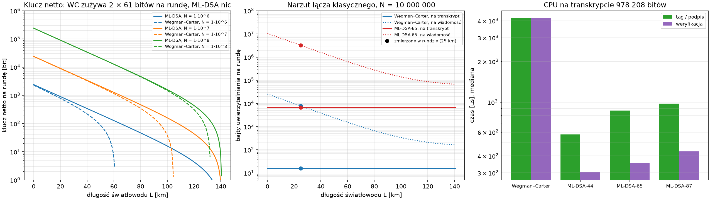

Uwierzytelnianie postkwantowe ([scenariusze i tabela modeli zagrożeń](figures/e10_pqc_auth.md)): ML-DSA nie zużywa klucza, więc przy 10⁶ impulsów na rundę bilans jest dodatni do ~140 km zamiast 60 km. Ceną są 2 × 3309 B na rundę i założenie obliczeniowe, które musi stać w trakcie sesji. Nagrany szyfrogram ML-KEM-768 oddaje po złamaniu krat cały sekret, a złamanie podpisu po sesji QKD nic Ewie nie daje.

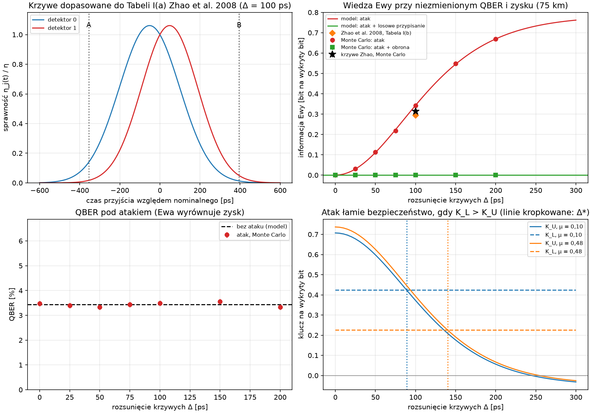

Atak time-shift ([tabele](figures/e11_time_shift.md)): z krzywymi sprawności dopasowanymi do Zhao et al. 2008 odtwarzamy ich Tabelę I(c) (K_U = 1130,9 i K_L = 1296,8 bitu wobec 1131 i 1297). W łączu GYS przy 75 km Ewa zna 0,31 bitu na wykryty bit przy niezmienionym QBER i zysku. Atak łamie bezpieczeństwo (K_L > K_U) od rozsunięcia krzywych 89 ps przy μ = 0,1, ale dopiero od 140 ps przy μ = 0,48, bo GLLP i tak usuwa część wielofotonową. Losowe przypisanie bit ↔ detektor zeruje wiedzę Ewy.

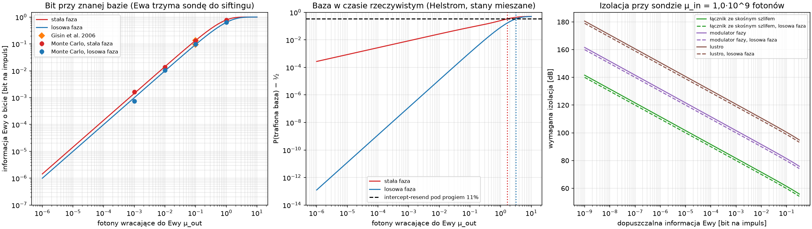

Atak Trojan horse ([tabele](figures/e12_trojan_horse.md)): odtwarzamy liczby Gisina et al. 2006 (0,135 i 0,095 bitu przy 0,1 fotonu wracającym do Ewy), a Monte Carlo w łączu GYS potwierdza, że QBER i zysk się nie zmieniają. Bazę w czasie rzeczywistym (do intercept-resend bez śladu w QBER) Ewa zgaduje dużo gorzej, gdy Alice losuje fazę: bez odniesienia fazowego pojedynczy foton nic o bazie nie mówi. Każdy rząd wielkości mocy sondy to 10 dB izolacji więcej, a losowa faza oszczędza 1,6 dB. Z sondą ograniczoną progiem uszkodzenia światłowodu ten sam rachunek odtwarza Tabelę I Lucamariniego et al. 2015: 170, 200 i 230 dB izolacji przy 1 GHz, 1 MHz i 1 kHz.

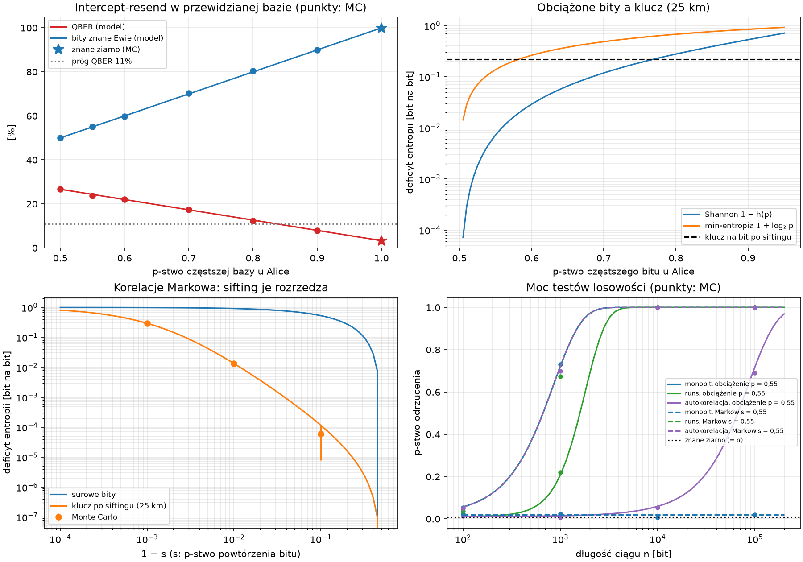

Słaby generator Alice ([tabele](figures/e13_weak_rng.md)): MT19937 o znanym ziarnie przechodzi testy monobit, runs i autokorelacji jak prawdziwy generator, a Ewa, odtwarzając go, zna cały klucz przy niezmienionym QBER i zysku. Obciążenie baz pozwala na intercept-resend z mniejszym QBER (pod progiem 11% od p ≈ 0,84). Obciążenie bitów 0,55 kosztuje 3,3% klucza asymptotycznie, ale w rachunku min-entropii ponad połowę. Korelacje Markowa w bitach sifting prawie wymazuje: przy 25 km zostaje 0,3% impulsów.

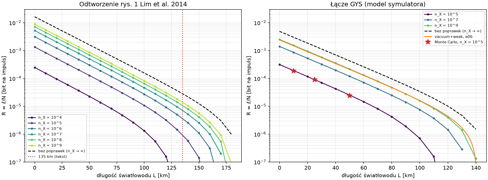

Skończony klucz dla WCP ze stanami decoy (Lim et al. 2014, [tabele](figures/e14_finite_key_decoy.md)): odtwarzamy liczby z artykułu (135 km przy bloku 10⁴ bitów, stopa dla 10⁹ ok. 1,78 razy wyższa niż dla 10⁷ przy 100 km), a każdy krok wzorów zgadza się z `qkd`. W łączu GYS blok 10⁵ bitów skraca zasięg ze 148 do 121 km. Rachunek na licznikach z Monte Carlo daje długość klucza w granicach kilku procent od modelu.

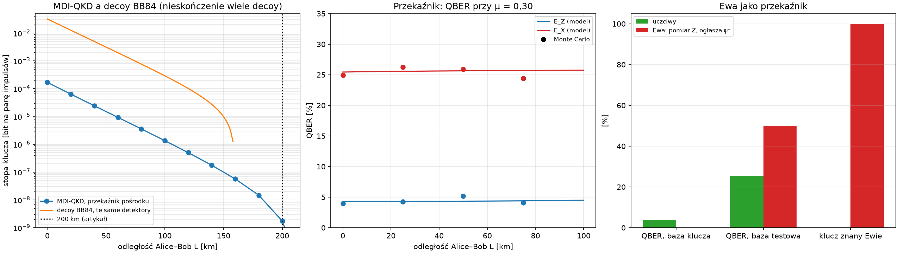

MDI-QKD (Lo, Curty, Qi 2012, [tabele](figures/e15_mdi_qkd.md)): Alice i Bob wysyłają stany do niezaufanego przekaźnika z pomiarem Bella, więc ataki na detektory przestają działać. Przekaźnik ma dokładną fizykę stanów koherentnych; zyski i QBER zgadzają się ze wzorami Ma i Razaviego w `qkd`, a Monte Carlo z modelem. Przy parametrach z artykułu zasięg wynosi 207,5 km (artykuł: ponad 200 km), wobec 159,6 km dla decoy BB84 z tymi samymi detektorami. Ewa jako przekaźnik może znać cały klucz bez błędów w bazie klucza, ale baza testowa pokazuje wtedy 50% błędów.

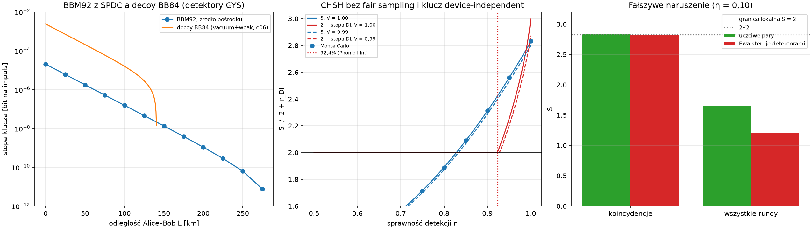

Splątane pary ([tabele](figures/e16_entangled.md)): BBM92 ze źródłem SPDC pośrodku (dokładny model wielu par, zgodny z Ma, Fungiem i Lo) sięga z detektorami GYS 286 km, dwa razy dalej niż decoy BB84, ale przy stopie ok. 100 razy niższej. Test CHSH bez założenia fair sampling wymaga sprawności detekcji ponad 82,8% dla S > 2 i ponad 92,3% dla klucza device-independent (Pironio i in.: 92,4%). Ewa sterująca detektorami daje na samych koincydencjach S = 2√2 jak prawdziwe splątanie, a na wszystkich rundach S < 2.

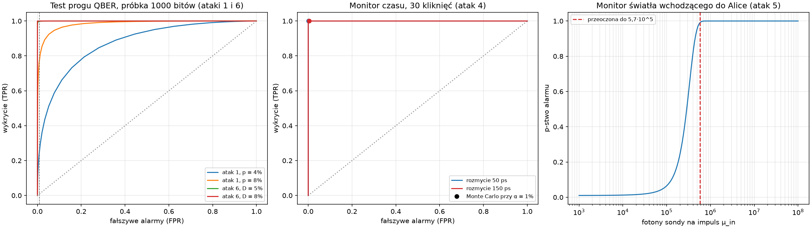

Obrony z progiem dla ataków 1, 4, 5 i 6 ([tabele](figures/e17_detection_roc.md)): test progu QBER na próbce 1000 bitów ma dokładną krzywą ROC (liczba błędów to rozkład dwumianowy) i wykrywa przechwycenie 4% impulsów w 23,4% sesji przy 1% fałszywych alarmów, a atak Fuchsa z D = 5% w 99,8%. Monitor czasu przyjścia kliknięć wykrywa time-shift po 30 kliknięciach nawet przy rozmyciu 150 ps. Fotodioda na wejściu Alice przepuszcza tylko sondy do 5,7·10⁵ fotonów, więc wymagana izolacja spada ze 102 do 69,2 dB.

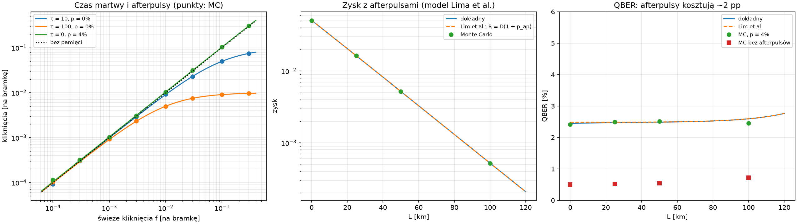

Czas martwy i afterpulsy ([tabele](figures/e18_detector_memory.md)): Monte Carlo zgadza się ze wzorem odnowienia c = 1/(τ + 1 + (1 − p)(1/f − 1)) na czterech rzędach wielkości f. Afterpuls działa jak niezależne ciemne zliczenie, więc tor BB84 z afterpulsami ma model dokładny; wzory Lima et al. 2014 to jego pierwszy rząd, gdy p_ap liczy także kaskady (p/(1 − p)). Afterpulsy 4% podnoszą QBER o 2 pp, cztery razy więcej niż błąd optyki.

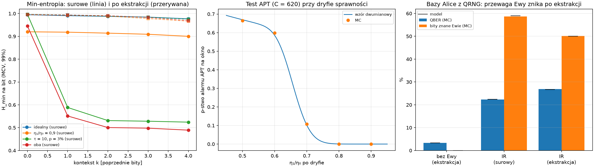

QRNG na dzielniku wiązki ([tabele](figures/e19_qrng.md)): obciążenie surowych bitów zgadza się z dokładnym wzorem także przy czasie martwym i afterpulsach. Czas martwy odwraca kolejne bity (P(bit = poprzedni) = 0,34), czego nie widać w min-entropii bez kontekstu (0,95), a z kontekstem 4 bitów spada ona do 0,49. Ekstrakcja Toeplitzem z tą min-entropią daje bity, które przechodzą testy. Testy zdrowia NIST SP 800-90B (progi zgodne z Tabelą 2 normy) nie alarmują na zdrowym generatorze, wykrywają oślepiony detektor po 41 bitach, a dryf sprawności z p-stwem na okno zgodnym ze wzorem dwumianowym.

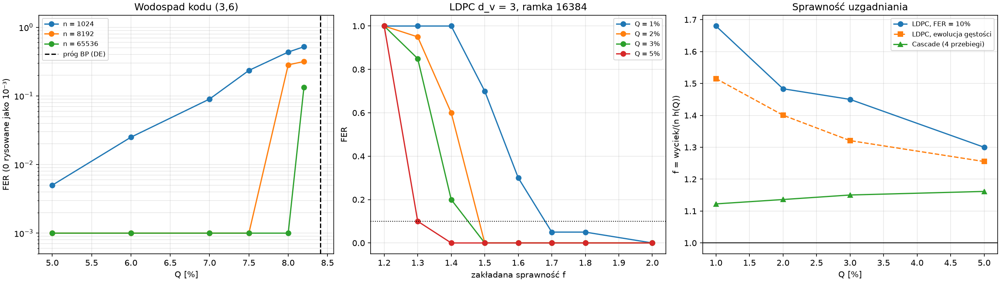

Uzgadnianie LDPC z syndromem ([tabele](figures/e20_ldpc.md)): ewolucja gęstości daje próg BP kodu (3,6) 0,0841 wobec 0,084 u Richardsona i Urbankego (2001). LDPC wysyła jedną wiadomość na ramkę zamiast 170–850 wiadomości Cascade na 16 384 bity, ale kody regularne potrzebują f ≈ 1,3–1,7 wobec ≈ 1,15 dla Cascade. Na torze GYS 25 km klucz końcowy z LDPC jest o 18% krótszy, za to uzgadnianie zajmuje 5 wiadomości zamiast 1916.

## Szybki start

```bash
git clone https://github.com/Shertie/BB84-Attack-Sim.git
```

```bash
cd BB84-Attack-Sim
```

```bash
python3 -m venv .venv
```

```bash
.venv/bin/pip install -e '.[dev,crosscheck,verify]'
```

```bash
make check
```

```bash
make figures
```

`make check` uruchamia lintera (ruff), sprawdzanie typów (mypy --strict) i szybkie testy. Pozostałe cele: `make test-slow` (testy statystyczne i krzyżowe), `make coverage` (pokrycie rdzenia), `make report` (raport LaTeX).

## Dokumentacja

- [docs/model.md](docs/model.md): założenia fizyczne i dowodu, konwencje, parametry, model każdego ataku i rozszerzenia
- [docs/architecture.md](docs/architecture.md): tor impulsów, punkty ataku P1–P8, zasady konstrukcji, tabela ataków (moduł, eksperyment, testy, obrona) i powiązane narzędzia
- [report/main.tex](report/main.tex): raport (`make report`)
- [CHANGELOG.md](CHANGELOG.md): historia wersji

## Cytowanie i licencja

Metadane do cytowania: [CITATION.cff](CITATION.cff); archiwum w Zenodo: [doi:10.5281/zenodo.23840266](https://doi.org/10.5281/zenodo.23840266) (wszystkie wersje). Licencja MIT, patrz [LICENSE](LICENSE). Artykuły w `assets/` mają własne licencje i nie są częścią repozytorium.
