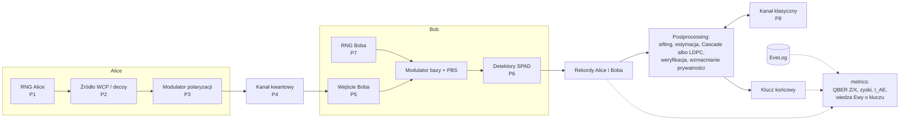

# Architektura: tor impulsów i punkty ataku

Tor kwantowy, postprocessing i osiem punktów, w których działają ataki (P1–P8).

## Punkty ataku

| Punkt | Miejsce | Typ hooka | Ataki | Obrony |
| --- | --- | --- | --- | --- |
| P1 | RNG Alice: bity, bazy, wybór intensywności | losowość | 8 | QRNG z ekstrakcją i testami zdrowia (`qrng.py`, `defenses/health_tests.py`), testy losowości |
| P2 | źródło: rozkład liczby fotonów | kwantowy | 3 (wykorzystuje impulsy wielofotonowe) | stany decoy |
| P3 | modulator Alice: światło wpuszczone z kanału | kwantowy (wsteczny) | 5 | izolator, monitor mocy (`defenses/input_monitor.py`), filtr |
| P4 | kanał kwantowy | kwantowy | 1, 3, 6 | test progu QBER (`defenses/qber_test.py`), monitor zysku, decoy |
| P5 | wejście Boba (przed PBS) | kwantowy | 2 (światło CW + faked states), 4 (przesunięcie w czasie) | monitor mocy/fotoprądu |
| P6 | detektory Boba | kwantowy (stan detektora) | 2, 4 (wykorzystywane podatności) | losowa sprawność, losowe przypisanie bit ↔ detektor, monitor czasu przyjścia (`defenses/timing_monitor.py`), MDI |
| P7 | RNG Boba: wybór bazy | losowość | 8 | jak P1 |
| P8 | kanał klasyczny | klasyczny + `Authenticator` | 7, pasywny podsłuch korekcji błędów (Cascade albo LDPC), fałszerstwo podpisu, podmiana klucza publicznego | Wegman–Carter, ML-DSA lub hybryda, odjęcie leak_EC |

## Zasady konstrukcji

- **Impulsy:** `Pulses` to zamrożona struktura tablic numpy (liczba fotonów, bit, baza, intensywność, kąt polaryzacji, czas przyjścia, moc klasyczna). Transformacje zwracają nowy obiekt.
- **Wiedza Ewy** trafia tylko do `EveLog`. Rekordy Alice i Boba są budowane wyłącznie z tego, co strony faktycznie obserwują, a estymacje (QBER, Y₁, e₁) przyjmują tylko te rekordy i transkrypt kanału klasycznego.
- **Dwie warstwy danych:** warstwa bitów trzyma pełne impulsy i rekordy (do ok. 10⁷ impulsów, postprocessing i ataki wymagające pełnej informacji); warstwa liczników przetwarza te same modele w paczkach i zwraca tylko zliczenia (do 10⁹–10¹⁰ impulsów). `run_counts_parallel` dzieli przebieg na części z osobnymi gałęziami jednej `SeedSequence`, więc wynik nie zależy od liczby procesów.
- **Trzy typy punktów wpięcia:** losowość (`RandomSource` wstrzykiwany Alice i Bobowi; atak 8, QRNG), kwantowy (funkcja na impulsach i `EveLog`; ataki 1–6, obrony sprzętowe) i klasyczny (`Message → Message` na kanale z transkryptem; atak 7, pasywny podsłuch, uwierzytelnianie).
- **Losowość:** osobne strumienie dla Alice, Boba, przyrody, Ewy i kanału publicznego, wyprowadzone z jednego ziarna; każdy wykres jest deterministyczny.
- **Konfiguracja:** pliki YAML wczytywane ściśle do zamrożonych dataclass (`config.py`): nieznany albo brakujący klucz to błąd, typy są sprawdzane. Ziarno jest częścią konfiguracji.
- **Uwierzytelnianie:** wspólny interfejs `Authenticator` (`postprocessing/auth.py`): Wegman–Carter z kluczem współdzielonym, podpis ML-DSA (`cryptography`, zgodność z `dilithium-py`) i hybryda obu.
- **Weryfikacja niezależna:** fragmenty kwantowe ataków 5 i 6 liczy też QuTiP (zależność `verify`); wzory analityczne porównujemy z pakietem `qkd` 0.2.0 (zależność `crosscheck`, jedyny punkt dostępu `tests/qkd_oracle.py`). Testy pomijają się, gdy pakiet nie jest zainstalowany.
- **Interfejs interaktywny:** `app/streamlit_app.py` zawiera tylko widok; scenariusze (łącze, atak skalibrowany jak w eksperymentach, model analityczny, postprocessing) są w `qkdsim.scenarios` i mają własne testy. Test `tests/unit/test_app.py` renderuje aplikację dla każdego ataku (`streamlit.testing`).
- **Metryki:** moduł `metrics` jest jedynym miejscem, które zestawia prawdę z wiedzą Ewy i z kluczem.

## Ataki: moduły, eksperymenty, testy i obrony

| Atak | Model | Eksperyment | Porównanie | Testy | Obrona i metryka | `docs/model.md` |
| --- | --- | --- | --- | --- | --- | --- |
| 1. Intercept-resend | `attacks/intercept_resend.py` | e04, e07, e17 | ¼ + ½·e_d (model dokładny w `analysis/intercept_resend.py`) | `unit/test_intercept_resend.py`, `stat/test_intercept_resend_mc.py` | `defenses/qber_test.py`: dokładna ROC dwumianowa, 4% przechwytu wykryte w 23,4% sesji, AUC 0,872 (e17) | rozdz. 8 |
| 2. Oślepianie | `attacks/blinding.py` | e05 | progi Clavis2 (Lydersen et al. 2010) | `unit/test_blinding.py`, `stat/test_blinding_mc.py` | `defenses/random_attenuation.py`, `defenses/power_monitor.py`, ROC w e05; MDI-QKD (e15) | rozdz. 8 |
| 3. PNS | `attacks/pns.py` | e06 | R(L) i L_kryt z Ma et al. 2005 | `unit/test_pns.py`, `stat/test_pns_mc.py` | `defenses/decoy_check.py`: z od −69 do −10, AUC = 1 (e06) | rozdz. 8 |
| 4. Time-shift | `attacks/time_shift.py` | e11, e17 | Tabela I(c) Zhao et al. 2008 (1131 i 1297) | `unit/test_time_shift.py`, `stat/test_time_shift_mc.py` | `defenses/timing_monitor.py`: wykrycie 100% przy 1% fałszywych alarmów (e17); losowe przypisanie bit ↔ detektor (`Link.random_assignment`, e11); MDI-QKD | rozdz. 8 |
| 5. Trojan horse | `attacks/trojan_horse.py` | e12, e17 | 0,135 i 0,095 bitu (Gisin et al. 2006), QuTiP; Tabela I Lucamariniego et al. 2015 | `unit/test_trojan_horse.py`, `stat/test_trojan_horse_mc.py`, `crosscheck/test_trojan_qutip.py` | `defenses/input_monitor.py`: niezauważona sonda ≤ 5,7·10⁵ fotonów, potrzebna izolacja 69,2 dB (e17) | rozdz. 8 |
| 6. Fuchs | `attacks/optimal_individual.py` | e08, e17 | D\* = 14,64% (Fuchs et al. 1997), QuTiP | `unit/test_optimal_individual.py` (MC a wzór), `crosscheck/test_fuchs_qutip.py` | `defenses/qber_test.py`: D = 5% wykryte w 99,8% sesji (e17); próg Shora–Preskilla | rozdz. 10 |
| 7. MITM | `attacks/mitm.py` | e09, e10 | fałszerstwo ≤ L/p (Wegman, Carter 1981) | `unit/test_auth_mitm.py` (p-stwo 1/p, z-score), `unit/test_pqc_auth.py` | uwierzytelnianie w `postprocessing/auth.py` i `postprocessing/pqc_auth.py` (część protokołu): przerwanie przy pierwszym tagu Ewy | rozdz. 11 |
| 8. Słaby generator | `attacks/weak_rng.py` | e13, e19 | p-wartości NIST SP 800-22, model z trafieniem bazy; QRNG: obciążenie dokładne, progi NIST SP 800-90B | `unit/test_weak_rng.py`, `stat/test_weak_rng_mc.py`, `unit/test_qrng.py`, `stat/test_qrng_mc.py` | `defenses/randomness_tests.py` (moc w funkcji długości ciągu, e13); QRNG z ekstrakcją (`qrng.py`) i `defenses/health_tests.py` (e19) | rozdz. 8 i 15 |

Każdy eksperyment w `experiments/` kończy się błędem, gdy wynik wyjdzie poza tolerancję względem wzoru albo liczby z publikacji. Testy statystyczne porównują Monte Carlo z modelem przez z-score (|z| < 4) przy stałych ziarnach.

## Powiązane narzędzia

| Projekt | Zakres | Podejście do ataków |
| --- | --- | --- |
| [`qkd`](https://github.com/plutoniumm/qkd) (MIT, rdzeń w Rust) | DV i CV-QKD, m.in. BB84 z WCP i decoy, MDI, BBM92; tabela walidacji względem publikacji | wycena w formie zamkniętej (oślepianie, niedopasowanie sprawności, blanking, Trojan horse z granicą Lucamariniego et al.), bez Monte Carlo na impulsach |
| [`qkdsec`](https://github.com/John-Jepsen/qkdsec) (Apache-2.0) | BB84 (Qiskit i backend klasyczny), Shor–Preskill, decoy, poprawka Tomamichela | wstrzykiwany szum podsłuchu |
| [NuQKD](https://arxiv.org/abs/2310.12351) | modularny symulator BB84 z niedoskonałościami urządzeń | intercept-resend |
| [SeQUeNCe](https://arxiv.org/abs/2009.12000) | symulator zdarzeń dyskretnych sieci kwantowych, BB84 i Cascade | bez katalogu ataków |

Czym ten projekt się różni:

1. **Monte Carlo na poziomie impulsów zamiast wyceny wzorem.** Atak jest wykonywany na tablicy impulsów (liczba fotonów, kąt, czas, stan detektora), a wzór służy do walidacji wyniku. Widać więc fluktuacje, p-stwo wykrycia przy skończonej próbce i krzywe ROC obron.
2. **Pełny tor do klucza końcowego.** Cascade albo LDPC i wzmacnianie prywatności działają na prawdziwych bitach, a wiedza Ewy o kluczu końcowym jest mierzona, np. dokładnie dla liniowej Ewy nad GF(2).
3. **Ataki spoza `qkd`:** aktywny PNS z dopasowaniem zysku, optymalny atak indywidualny Fuchsa, MITM z uwierzytelnianiem i bilansem klucza, słaby generator losowy; do tego uwierzytelnianie postkwantowe (`qkd` nie ma modułu uwierzytelniania).
4. **`qkd` jako niezależna wyrocznia:** te same wzory (Ma et al. 2005, Lim et al. 2014, Ma i Razavi dla MDI, Ma, Fung i Lo dla BBM92) liczymy niezależnie i porównujemy w testach krzyżowych.
