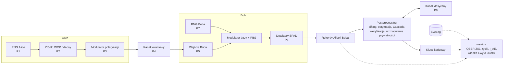

# Architektura: tor impulsów i punkty ataku

Odtworzenie diagramu „architektura symulatora · tor kwantowy, postprocessing, 8 punktów ataku” z planu projektu. W pliku .md planu zachował się tylko znacznik osadzonej treści. Harmonogram (drugi utracony diagram) jest w [ROADMAP.md](../ROADMAP.md), rozdz. 5.

## Punkty ataku

| Punkt | Miejsce | Typ hooka (ADR 0003) | Ataki | Obrony |
| --- | --- | --- | --- | --- |
| P1 | RNG Alice: bity, bazy, wybór intensywności | losowość | 8 | QRNG, testy losowości |
| P2 | źródło: rozkład liczby fotonów | kwantowy | 3 (wykorzystuje impulsy wielofotonowe) | stany decoy |
| P3 | modulator Alice: światło wpuszczone z kanału | kwantowy (wsteczny) | 5 | izolator, monitor mocy, filtr |
| P4 | kanał kwantowy | kwantowy | 1, 3, 6 | QBER, monitor zysku, decoy |
| P5 | wejście Boba (przed PBS) | kwantowy | 2 (światło CW + faked states), 4 (przesunięcie w czasie) | monitor mocy/fotoprądu |
| P6 | detektory Boba | kwantowy (stan detektora) | 2, 4 (wykorzystywane podatności) | losowa sprawność, losowe przypisanie bit ↔ detektor, MDI |
| P7 | RNG Boba: wybór bazy | losowość | 8 | jak P1 |
| P8 | kanał klasyczny | klasyczny + `Authenticator` (ADR 0006) | 7, pasywny podsłuch korekcji błędów, fałszerstwo podpisu, podmiana klucza publicznego | Wegman–Carter, ML-DSA lub hybryda, odjęcie leak_EC |

## Zasady

- Wiedza Ewy trafia tylko do `EveLog`. Rekordy Alice i Boba są budowane wyłącznie z tego, co strony faktycznie obserwują (ADR 0001).
- Moduł `metrics` jest jedynym miejscem, które zestawia prawdę z wiedzą Ewy i z kluczem.
- Ten sam tor działa w warstwie bitów i w warstwie statystyk (ADR 0002).
